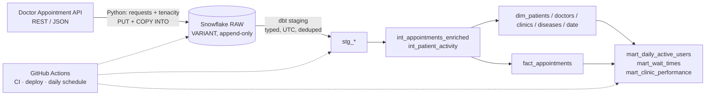
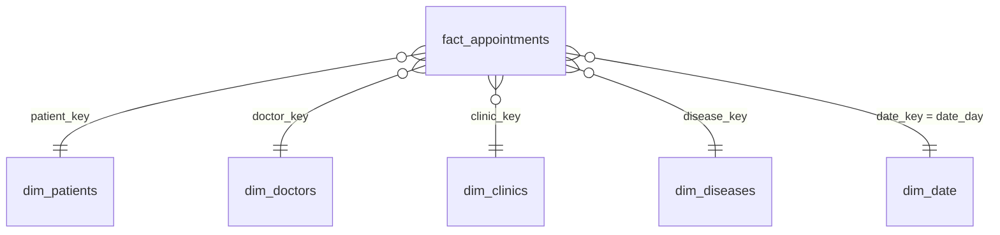

# Healthcare Patient Portal Analytics — Modern Data Stack (ELT)

A hospital network launches a telehealth app. Leadership wants **daily active users**, **appointment wait times** and **clinic performance**, but the data lives behind a scheduling API. This project builds the full path from API to trusted, tested, documented metrics.



| Layer | Tooling | Key decisions |
|---|---|---|
| Extract/Load | Python 3.12, `requests`, `tenacity`, Snowflake connector | Raw JSON landed untouched; **all endpoints fetched before any load** (no half-updated RAW); bulk `PUT`+`COPY`; row-count verified; audit row per load |
| Transform | dbt Core 1.11 + dbt_utils | Kimball star schema; business logic isolated in an intermediate model so it is **unit tested**; "Unknown" dimension members so facts never lose rows |
| Quality | dbt generic + singular + unit tests, source freshness | Critical rule (`end_time > start_time`) blocks the build; softer checks warn |
| CI/CD | GitHub Actions | Slim CI (`state:modified+` + `--defer`) into a throw-away schema per PR; prod deploy on merge; daily scheduled pipeline; dbt docs on Pages |
| Security | Key-pair auth, least-privilege roles, `LOADER` vs `TRANSFORMER` | PII not exposed in `dim_patients` (initials, hashed phone, age band) |

## Data model (Kimball)

`fact_appointments` — **grain: one row per appointment.**



## Metric definitions (read before quoting numbers)

| Metric | Definition | Caveat |
|---|---|---|
| **Daily active users** | Distinct patients who **booked** an appointment or **arrived** for one that day | The API exposes **no login/session events**, so this is a proxy for portal activity. Said plainly rather than faked. |
| **Wait time (min)** | `consultation_started_at − arrived_at`; NULL if either is missing or the order is impossible | Optional fallback to scheduled start via `wait_time_fallback_to_scheduled_start`. Minutes are boundary-counted (Snowflake `DATEDIFF`). |
| **Arrival delay** | `arrived_at − scheduled start` (negative = early) | |
| **Completion / cancellation / no-show rate** | share of appointments by status group | Status → group mapping lives in `vars` and is guarded by a test that flags unknown statuses |

## ⚠️ Read this first: source schema status

The provider's docs publish endpoints and only a `/roles` sample, **not** the appointment/patient field names. So:

* `vars.field_map` in `dbt_project/dbt_project.yml` is the **single place** that maps each canonical column to candidate JSON keys (case-insensitive, first non-null wins). `roles` is taken from the provider's sample; the rest are **best-effort candidates**.
* `make profile` calls the live API and writes `docs/api_profile.md` showing, per field, which candidate matched or **MISSING** (exit code 1 if a required field is unmapped).
* `dbt run-operation assert_field_coverage` re-checks against RAW in Snowflake and fails loudly instead of letting columns silently become NULL. The daily workflow runs it every day.

**Do this once:** run `make profile` → adjust `field_map` → commit. If the API has no end time or consultation-start field, set `default_slot_minutes` / `wait_time_fallback_to_scheduled_start` and the model will flag derived values (`is_end_time_derived`).

## Quick start

```bash
git clone <your-repo> && cd telehealth-analytics
python -m venv .venv && source .venv/bin/activate
cp .env.example .env            # fill values, then: set -a; source .env; set +a
make install

make profile                    # 1. inspect the real API; fix vars.field_map
make extract-dry                # 2. optional: fetch + save JSON locally, no Snowflake

# 3. one-time Snowflake bootstrap: edit public keys, then run in a worksheet / snowsql
#    extract_load/sql/setup_snowflake.sql

make extract                    # 4. load RAW
make deps && make validate      # 5. install dbt_utils; verify field mapping vs RAW
make build                      # 6. models + all tests (dev schema dbt_<you>)
make docs                       # 7. lineage site
```

GitHub secrets: `SNOWFLAKE_ACCOUNT`, `SNOWFLAKE_LOADER_USER`, `SNOWFLAKE_LOADER_PRIVATE_KEY`, `SNOWFLAKE_DBT_USER`, `SNOWFLAKE_DBT_PRIVATE_KEY` (PEM text), optional `SLACK_WEBHOOK_URL`. Enable **Settings → Pages → GitHub Actions**, and require the `CI` checks on `main`.

## Data-quality strategy

| Test | Where | Severity |
|---|---|---|
| `end_time > start_time` | singular on staging **and** `expression_is_true` on fact | **error** (blocks downstream) |
| PK `unique`/`not_null`, FK `relationships` on every dimension key | marts | error |
| Orphan ids (patient/doctor missing in dims) | staging `relationships` | warn |
| Unknown-member share < 5 % | singular | warn |
| Doctor double-booking (overlap) | singular | warn |
| Wait minutes in `[0, 1440]`; arrival ≤ consultation start | fact / singular | warn |
| Unrecognised appointment status | singular | warn |
| Staged rows == rows extracted (`EXTRACT_LOG`) | singular | warn |
| Source freshness (warn 30 h / error 72 h) | `dbt source freshness` | per threshold |
| Wait / delay / lead-time / status-flag logic | **dbt unit tests** with fixtures | error |

Failing rows are stored in the `test_failures` schema (`store_failures`). Expect a practice API to trip a few warnings on first run — decide per rule whether to fix upstream mapping, quarantine, or relax severity, and record it here.

## What was verified before publishing

| Check | Result |
|---|---|
| 19 Python unit tests (payload normalisation, no-load-on-failure, empty-response guard, SQL-identifier safety, COPY flow, row-count check) | ✅ passing |
| `dbt parse` on dbt-core 1.11 | ✅ no errors, no deprecation warnings |
| All 18 models + 6 singular tests rendered through Jinja with real macros/vars and parsed with a Snowflake-dialect SQL parser | ✅ |
| Unit-test fixtures executed against the rendered `int_appointments_enriched` SQL (DuckDB) | ✅ expected values match |
| Run end-to-end against live Snowflake and the live API | ⚠️ **not done** — do `make profile` and a first `make build` and note any adjustments |

## Possible extensions
SCD-2 snapshots for `dim_doctors`; `fact_doctor_schedule_slots` for utilisation (needs the schedule time format from `make profile`); incremental fact once volumes grow; Streamlit/Metabase dashboard on the three marts; dbt `exposures`; model contracts once column types are confirmed.

## Repo layout
```
extract_load/   config · extract · snowflake_loader · profile_api · sql/setup_snowflake.sql
dbt_project/    models/{staging,intermediate,marts} · macros · tests · dbt_project.yml (field_map) · profiles.yml
tests/          pytest for the Python layer
.github/workflows/  ci.yml · deploy.yml · pipeline.yml
```
